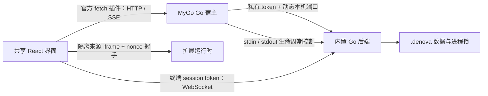

# Web 与 Desktop 分发

Denova 复用 `web/` 的 React 界面、Go HTTP API 和数据格式。桌面宿主使用 MyGo 0.7.4，macOS 使用系统 WKWebView，Windows 使用 WebView2，不内置 Chromium 或 Node.js。Desktop 仅发行 macOS arm64 与 Windows x64；Web 保留原有五个平台的压缩包。

## 使用与数据

| 分发 | 安装产物 | 更新 |
| --- | --- | --- |
| Web | `denova-v<version>-<platform>.tar.gz/.zip` | 原有 Go updater |
| Desktop macOS | `denovadesktop-<version>-arm64.dmg` | MyGo 官方 updater |
| Desktop Windows | `denovadesktop-setup-<version>-amd64.exe` | MyGo 官方 updater |

macOS 将 Denova 拖入 Applications。Windows 使用 MyGo 生成的按用户安装器，缺少 WebView2 时由官方安装流程处理运行时依赖。首次启动选择 `~/.denova` 或已有数据根目录，不会再追加 `.denova`。Web 与 Desktop 可使用同一个目录，但必须先退出另一个实例；旧发行版不识别进程锁，切换前同样需要退出。

在「设置 → 数据目录」或原生菜单切换目录。应用停止原后端、重启并加载新目录，不自动复制或移动数据；存在运行任务或已启用自动化时先确认。主 React 页面、导航、编辑器与游戏设计维持原样；macOS 保留导航栏顶部红绿灯与拖动区域，Windows 保留原生标题栏。

关闭窗口会保留后台任务，macOS 可从 Dock 恢复，Windows 可从托盘恢复。「退出 Denova」检查任务，必要时确认，然后取消任务并完成 journal 落盘。后端或渲染进程故障显示重试、日志、数据目录选择和退出，不自动重放任务。

本次不改变最近正式发行版的项目、会话、游戏存档格式，不需要用户数据迁移。桌面 WebView 与浏览器分别存储界面偏好；未发行的 Electron 内核存储不做迁移。宿主设置、窗口存储和日志不进入可移动的 `.denova` 项目事实源。

## 运行边界



- `internal/desktop` 只管理窗口、原生菜单、目录对话框、后端进程、受限桥接和官方更新插件；业务及任务生命周期仍由后端拥有，`agent/` 不依赖 MyGo。
- 静态页面使用 MyGo 协议：macOS 为 `mygo://localhost`，Windows 为 `http://mygo.localhost`。WKWebView 自定义协议可能丢弃 POST body，因此 `/api/` 请求使用官方 fetch 插件，保留请求体、SSE 和取消。普通浏览器请求不经过此适配。
- 后端 token 由宿主生成，通过私有管道传递，不注入 JavaScript。代理检查主窗口与来源，删除外部认证信息，固定转发给拥有的后端。扩展 iframe 不获得原生桥接权限。
- WebSocket 只放行本机、正确桌面来源、终端 attach 路由，并由后端继续校验每个终端的 session token；仅伪造 Origin 不能访问普通业务 API。
- 扩展 iframe 在 WKWebView 中使用 `location.ancestorOrigins` 补足空 referrer，仍检查父窗口、准确 origin 和握手 nonce。
- 后端持有数据目录 OS 锁；宿主管道关闭触发正常关闭，宿主退出等待后端结束，包括更新重启。
- MyGo `userData/desktop.json` 保存目录选择、外观和版本通知，`updater.json` 保存官方更新偏好，日志位于 `userData/log/desktop.log`。`DENOVA_DESKTOP_USER_DATA` 可指定隔离的宿主目录；`DENOVA_DIR` 可覆盖初始数据根目录，手动切换后清除这个覆盖。

## 构建与开发

安装根 `go.mod` 要求的 Go、Node 和 pnpm。在原生目标系统运行：

```sh
pnpm --dir web install --frozen-lockfile
pnpm --dir desktop build:backend
pnpm --dir desktop dev:hmr
# 退出开发版后打包
pnpm --dir desktop package
```

`build:backend` 包含前端、内嵌资源、后端主程序、Skills、校验过的 ripgrep 和许可证。Desktop 不携带 Web updater；官方 updater 编译进 MyGo 宿主。`package` 调用 Go module 固定版本的官方 CLI，输出到 `desktop/dist/darwin-arm64/` 或 `desktop/dist/windows-amd64/`，无需 Bun、Electron 或 electron-builder。macOS 额外提供 ZIP 供手动解压。

`dev:hmr` 启动前台 Vite 实例，API 使用该桌面进程拥有的后端。切换目录后开发启动器按 MyGo 的重启约定保留 Vite 并重新启动宿主。修改前端会热更新；修改宿主或后端后重新构建并重启。macOS 可用 `scripts/restart-desktop.sh` 正常关闭当前仓库的桌面实例后启动 HMR。与 Web 开发实例并行时使用独立数据目录。

`DENOVA_RELEASE_FRONTEND_DIR` 可复用已验证的前端；`DENOVA_VERSION` 必须与两个 package.json 一致。`DENOVA_DESKTOP_TARGET=win32-x64` 可交叉编译后端，宿主也支持交叉编译；完整安装器、签名和行为验证需原生 Windows。

## 安装更新

使用 MyGo 官方 CLI 和 `plugins/updater`，不另建下载、签名校验、解包或安装状态机。设置页保留检查入口及自动检查、自动下载开关；检查、进度、重启由官方更新窗口处理。第一次启动从现有用户配置导入更新偏好，之后由官方插件持久化。自动下载开启时，官方插件安装更新并在下一次启动生效；主动重启仍经过 Denova 退出检查和后端收尾。

正式构建设置 `DENOVA_DESKTOP_RELEASE=true`，必须具备平台签名和更新密钥。缺少更新公钥的本地构建仍可运行，官方更新窗口提示未配置更新。

| 用途 | GitHub Actions 配置 |
| --- | --- |
| 更新公钥 | variable `DENOVA_DESKTOP_UPDATE_PUBLIC_KEY`，由 `mygo keygen` 生成 |
| 更新私钥 | secret `MYGO_UPDATER_PRIVATE_KEY`，保存 key 文件内容 |
| macOS 签名 | secrets `MAC_CERTIFICATE`（p12 的 HTTPS URL 或 base64）、`MAC_CERTIFICATE_PASSWORD` |
| macOS 公证 | secrets `APPLE_ID`、`APPLE_APP_SPECIFIC_PASSWORD`、`APPLE_TEAM_ID` |
| Windows 签名 | secrets `WINDOWS_CERTIFICATE`（pfx 的 HTTPS URL 或 base64）、`WINDOWS_CERTIFICATE_PASSWORD` |

本地可直接指定 `DENOVA_MAC_SIGNING_IDENTITY`、`DENOVA_MAC_NOTARY_PROFILE` 或 `DENOVA_WINDOWS_CERTIFICATE`（密码通过 `MYGO_WINDOWS_CERTIFICATE_PASSWORD`）。CI 证书准备仅在临时 runner 执行。私钥与证书不进入仓库。

官方 CLI 生成签名的 `denovadesktop-<version>-<os>-<arch>.tar.gz` 和 `update-<os>-<arch>.json`，发布时同安装器一起上传。使用独立的 `denovadesktop-` 前缀，防止已发行 Web 更新器按 `denova-` 与平台名匹配时误下载桌面包。当前采用全量归档更新，所有平台与 Web 共用 `v<version>` tag；Release 在资产齐全之前保持 draft。

## 验证

```sh
pnpm --dir desktop test
# 测试构建启用官方 automation 插件并关闭后台节流；生产包保留省电行为，不含插件或 inspector。
DENOVA_DESKTOP_E2E=true pnpm --dir desktop package
pnpm --dir desktop test:smoke
pnpm --dir desktop package
node desktop/test/package.mjs
```

以上环境变量写法适用于 Bash；Windows PowerShell 使用 `$env:DENOVA_DESKTOP_E2E='true'`，生产打包前删除该变量。Smoke 使用隔离数据、动态端口和确定性本地模型，覆盖写作输入保存、游戏生成、主题语言、扩展来源握手与存储读取、SSE 取消、终端认证、官方更新窗口、关闭隐藏、正常退出和重开。日志与截图位于 `output/desktop/`。Windows 测试通过一个小型 Go 客户端访问官方 AF_UNIX 自动化接口，不引入生产测试接口。

CI 在 macOS arm64 和 Windows x64 原生构建运行，并单独启动不含自动化的最终生产包。Windows 最终包启动检查的清理由测试进程终止，正常退出行为由前一阶段的原生菜单测试覆盖。

发布前仍需在两个原生系统验证签名旧版到新版的真实升级、系统信任提示、Windows 安装卸载、中文输入法及休眠恢复。未签名本地构建与交叉编译不代表这些检查通过。

## Electron → MyGo 实测（2026-11-04）

同一台 Apple M3 Pro、36 GiB 内存、macOS 27.0.1（26A434）。Electron 基线为迁移前 `f26d135c`，两边版本号均为 0.6.3，前端设计与测试文档相同。体积单位为 MiB（1,048,576 bytes）；内存、启动时间取三轮中位数。

| 指标 | Electron | MyGo | 变化 |
| --- | ---: | ---: | ---: |
| macOS DMG | 155.6 MiB | 33.0 MiB | −78.8% |
| macOS ZIP | 149.7 MiB | 42.6 MiB | −71.6% |
| 应用展开体积 | 381.4 MiB | 129.3 MiB | −66.1% |
| 空闲内存 | 733.3 MiB | 308.1 MiB | −58.0% |
| 打开长文档后的内存 | 892.1 MiB | 460.6 MiB | −48.4% |
| 启动至页面就绪 | 0.763 s | 0.911 s | +19.4% |

内存使用 macOS `footprint` 的进程组总计，包括宿主、Go 后端、渲染、GPU 和网络进程，不只统计主进程，也不相加 RSS。通过 Launch Services 启动应用，让 WebKit XPC 进程归入应用自己的 resource coalition；直接从终端执行会把终端自身的资源混入测量。MyGo 测量脚本为 `desktop/test/benchmark.mjs` 与 `coalition.py`。

每轮新建隔离用户数据，页面就绪后静置 3 秒，测量空闲内存；随后创建并打开约 35,000 字符的同一中文文档，再静置 3 秒测量。三轮内存（MiB，空闲 / 长文档）：Electron 为 723.6 / 909.8、739.2 / 892.1、733.3 / 878.9；MyGo 为 298.9 / 490.9、314.4 / 450.1、308.1 / 460.6。原始记录保存在本次工作区的 `output/desktop/electron-baseline.json` 和 `mygo-benchmark.json`。

启动三轮分别为 Electron 3.145 / 0.723 / 0.763 秒，MyGo 1.153 / 0.911 / 0.845 秒。两者均经过 Launch Services，但自动化连接方式不同、检查间隔为 100 ms，且没有清空系统文件缓存，因此不能当作严格冷启动结论。本次没有测出启动提速；明确收益是内存与安装体积。性能测试启用自动化，MyGo 测试包关闭后台节流；体积测量使用关闭自动化的生产包。

本地已通过根模块和 `agent/` 的完整 Go test/vet、前端 1,041 项单元测试、本地化检查、完整 Web 构建、macOS 原生 smoke 与生产包启动、DMG 校验和应用签名完整性检查。原生人工检查覆盖目录取消/切换/重启、中文与 emoji 粘贴保存、全屏进入退出。临时密钥验证了官方更新归档的防篡改检查、退出后整包替换及安装后哈希；不代表 Developer ID、公证或 Windows 系统信任流程已验证。Windows 宿主和后端交叉编译通过，原生行为以对应 CI 结果和发布前检查为准。

参考：[MyGo 官方仓库与文档](https://github.com/egoist/mygo)、[官方 updater 插件](https://github.com/egoist/mygo/tree/v0.7.4/plugins/updater)、[官方 fetch 插件](https://github.com/egoist/mygo/tree/v0.7.4/plugins/fetch)。
