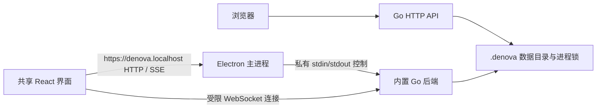

# Web 与 Desktop 分发

Denova 复用 `web/` 的 React 界面、Go HTTP API 和数据格式，提供两个启动入口：Web 主程序，以及 `desktop/` 中的 Electron 应用。Desktop 仅构建 macOS Apple Silicon 和 Windows x64；Web 保留原有五个平台的压缩包。

## 使用

| 分发 | 产物 | 启动与更新 |
| --- | --- | --- |
| Web | `denova-v<version>-<platform>.tar.gz/.zip` | 运行主程序，在浏览器访问；沿用 Go updater |
| Desktop macOS | `denova-desktop-<version>-mac-arm64.dmg` | 将 Denova 拖入 Applications；应用更新替换完整 bundle |
| Desktop Windows | `denova-desktop-<version>-win-x64.exe` | NSIS 按用户安装；应用更新替换完整安装 |

Desktop 首次启动可使用 `~/.denova` 或选择现有数据目录。选择的是数据根目录本身，不会再追加 `.denova`。目录不需要复制，现有 Web 数据可以继续使用；两种入口不能同时写入同一个目录。旧发行版不认识新增的锁，切换前仍须退出旧进程。

启动后可在「设置 → 数据目录」中查看当前路径并切换，也可使用原生应用菜单。设置入口会先保存待提交的设置，再选择目录；取消选择不改变当前目录。切换会停止当前后端并重启应用，不会自动复制或移动数据，有活动任务时会先确认。

关闭窗口保留后台任务。macOS 从 Dock 恢复，Windows 从托盘恢复；应用菜单中的「退出 Denova」会检查活动任务和已启用的自动化，确认后取消、落盘并退出。后端故障显示重试、日志和数据目录选择，不自动重放任务。

macOS 原生红绿灯位于主导航上方，折叠后的导航宽度随系统按钮安全区域调整；右侧复用 Web 的圆角工作区，页面顶部不再为红绿灯或导航按钮避让。Desktop 的折叠态采用上方图标、下方小文字的紧凑导航；通过右键菜单折叠、展开，也可拖动右边缘跨过阈值切换状态，右键展开恢复上次宽度。边缘获得键盘焦点后，左右方向键调整宽度，Enter 切换展开状态，Home 折叠，End 展开到最大宽度；Escape 取消正在进行的拖动。顶部空白可拖动窗口，按钮、输入、标签页和导航拖动边缘保留正常交互。Web 保留可见折叠按钮，Windows 保留原生标题栏。

## 进程与数据边界



- Go 是业务和任务生命周期的唯一所有者。Electron 负责窗口、原生菜单、目录选择、后台进程和应用更新；`agent/` 不依赖桌面分发。
- `https://denova.localhost` 是应用内固定 origin，由 Electron 直接处理，不需要监听 443 或安装证书；Go 使用 OS 分配的可用端口。标准 HTTPS 来源保留扩展 iframe 的 referrer / CSP 语义，HTTP / SSE 代理直接转发流和取消，保留主题、语言和面板的浏览器存储。
- 每次启动通过私有管道交付随机 token。WebSocket 仅向该窗口的主 frame、该后端的终端路由注入 token；后台再次验证本机来源和 origin。受限 preload 不暴露 Node、文件系统或通用 IPC。
- Go 在完整生命周期持有 `runtime/instance.lock` 的 OS 文件锁；正常退出和崩溃都会释放锁。Desktop 父进程管道关闭会触发 Go 的正常关闭流程，包括 Windows。
- Electron 的 `userData/desktop.json` 保存数据目录选择、原生外观和更新完成记录；日志在 `userData/log/`。这些宿主状态不写入 `.denova` 的可移动项目事实源。
- `DENOVA_DIR` 可显式指定本次启动的数据根目录；手动切换目录后，应用重启使用新选择并清除继承的覆盖值。`DENOVA_DESKTOP_USER_DATA` 可指定独立的 Electron 配置目录，用于隔离测试。二者都由进程启动环境提供，页面不能直接设置环境变量。
- 本次不改变项目、会话或存档的数据格式，不需要新增用户数据迁移。Electron 与原先浏览器拥有各自的界面偏好存储。

## 构建与验证

在原生 macOS arm64 或 Windows x64 环境安装 Go、Node 和 pnpm，仓库根目录执行：

```sh
pnpm --dir web install --frozen-lockfile
pnpm --dir desktop install --frozen-lockfile
pnpm --dir desktop build:backend
pnpm --dir desktop dev
pnpm --dir desktop package
```

`build:backend` 包含共享前端、内嵌资源、Go 主程序、Skills、已校验的 ripgrep 和许可证；不会携带 Web updater。`package` 输出到 `desktop/dist/`。可用 `DENOVA_RELEASE_FRONTEND_DIR` 复用已验证的前端产物；`DENOVA_VERSION`、前端版本和 desktop package 版本必须一致。`DENOVA_DESKTOP_TARGET=win32-x64` 可交叉构建 Windows payload，但不能替代 Windows 原生验证。

### 在桌面窗口热更新前端

首次运行前执行 `pnpm --dir desktop build:backend`。退出已打开的桌面版，在仓库根目录启动开发版。

```sh
pnpm --dir desktop dev:hmr
```

保存 `web/src/` 中的改动后，Vite 会热更新组件和样式。部分模块变化会刷新整个窗口。修改 Electron 主进程或 preload 后重启开发版。修改 Go 后先重建后端，再重启开发版。

开发版启动自己的本机 Vite 实例，并通过桌面应用启动的 Go 后端处理 API 请求。与 Web 后端并行运行时，为两者选择不同的数据目录。

### 运行桌面测试

```sh
pnpm --dir desktop test
pnpm --dir desktop test:smoke
# 在已完成 package 后，设置 DENOVA_DESKTOP_PACKAGED=true 再运行 test:smoke
```

smoke 使用临时数据、动态端口和确定性本地模型，覆盖真实写作保存、游戏回合、扩展 iframe 握手与存档、复制与全屏、SSE、终端连接、进程互斥、关闭窗口、退出和重开。不会使用用户模型或用户数据，复制验证后恢复剪贴板。截图和日志在 `output/playwright/desktop/`。CI 在 macOS arm64 与 Windows x64 原生执行，结果纳入必需的 Test and build 检查。

## 发布与更新

Desktop 使用 electron-builder / electron-updater。macOS 同时生成 ZIP 和 `latest-mac.yml` 供更新器使用；Windows 生成 EXE、blockmap 和 `latest.yml`。所有资产与 Web 共享一个 Release tag。Desktop 文件名故意使用 `mac-arm64` / `win-x64`，避免被旧 Web 更新器误判为 `darwin-arm64` / `windows-x64` 的 Web 压缩包。

发布 workflow 要求以下 GitHub Actions secrets：

| 平台 | Secrets |
| --- | --- |
| macOS 签名 | `MAC_CERTIFICATE`（Developer ID Application p12 URL 或 base64）、`MAC_CERTIFICATE_PASSWORD` |
| macOS 公证 | `APPLE_ID`、`APPLE_APP_SPECIFIC_PASSWORD`、`APPLE_TEAM_ID` |
| Windows 签名 | `WINDOWS_CERTIFICATE`（代码签名 pfx URL 或 base64）、`WINDOWS_CERTIFICATE_PASSWORD` |

正式发布强制签名；macOS 同时要求公证凭据。CI 和本地无证书构建可验证运行与打包，但不是可证明 Gatekeeper / SmartScreen 放行的正式发行包。Windows 使用硬件或云托管签名时，应将签名提供商接到 electron-builder 的签名配置，不能把私钥导出要求当作强制产品前提。

自动检查和下载复用已有用户设置。下载与安装分离，正常退出不会静默安装；「任务完成后重启」复用 Go 的任务检查与准入隔离，避免检查空闲后又接入任务的竞态。重启前 Go 必须已完成收尾；更新失败可重启当前后端并查看日志。浏览器访问 Desktop 后端时，更新设置提示到桌面应用管理。

每次正式发布仍需在两个原生系统验证已签名旧版本到新版本的实际升级、系统信任提示、Windows 安装/卸载、中文输入法及休眠恢复。交叉编译、更新状态测试和未签名应用启动不能证明这些系统行为。

设计参考：[DeepSeek Harness Desktop](https://github.com/deepseek-ai/deepseek-harness/blob/master/apps/desktop/README.md)、[Electron protocol](https://www.electronjs.org/docs/latest/api/protocol)、[electron-builder auto update](https://www.electron.build/auto-update.html)、[GitHub runner 平台](https://docs.github.com/en/actions/reference/runners/github-hosted-runners)。
